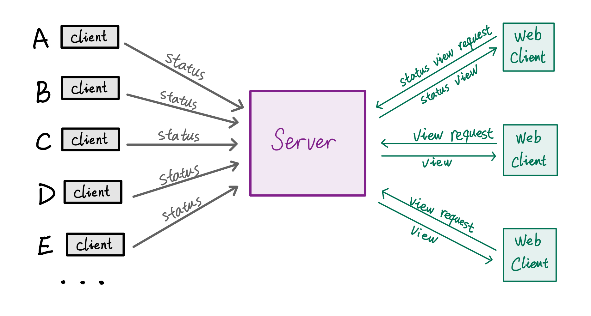

# MXStatus

_MXStatus is a comprehensive system for monitoring the system status of multiple Linux machines from a centralized server._

## System Structure

_MXStatus_ is composed of three main components: Client, Server, and Web Client.



#### Client

The Client component is installed on each Linux machine that you want to monitor. It actively periodically posts the host machine's status to the central server.

#### Server

The Server is deployed on a publicly accessible cloud server with a fixed IP address. It runs API endpoints to receive status updates from all clients. It also handles requests from the Web Client.

#### Web Client

The Web Client serves as the user interface to interact with the server and view the status of the monitored workstations.

## Deployment

### Deploy Server

We use Docker for easy server deployment. Follow these steps to get your server up and running:

1. Make sure you have [Docker](https://docs.docker.com/get-docker/) installed.

2. Clone this repository; Navigate to the project root directory.

3. Configure a private `.env` file as described in the [server setup](server/README.md).
   Set `MXSTATUS_ADMIN_TOKEN` and optionally bootstrap report/view keys and machine IDs.
   The published development credentials are no longer accepted. Put public deployments
   behind an HTTPS reverse proxy.

4. Run the following command to deploy the server:

    ```bash
    docker compose up --build -d
    ```

5. To tear down the server and remove the Docker image, run:

    ```bash
    docker compose down --rmi all
    ```

### Install Client

Please refer to the [Client INSTALL.md](client/INSTALL.md).

## Development

This section is for developers who want to contribute to the development of _MXStatus_.

### Setup Environment

To set up the development environment:

Use Python 3.12 or newer. With [uv](https://docs.astral.sh/uv/), run `uv sync` to install the locked runtime and development dependencies. Alternatively:

1. Create a virtual environment:

    ```bash
    python3.12 -m venv venv
    source venv/bin/activate
    ```

2. Install the required dependencies:

    ```bash
    pip install -r requirements.txt
    ```

### Run Development Server

Export the [server configuration](server/README.md#configure-access), then run from the project root directory:

```bash
uv run uvicorn server.main:app --reload --port 5000 --no-access-log
```

### Run Client

For testing the Client component:

1. Navigate to the 'client' directory:

    ```bash
    cd client
    ```

2. Run the Client using:

    ```bash
    python3 main.py
    ```

### Checks

```bash
uv run pytest
uv run ruff check server client tests
uv run ruff format --check server client tests
```

After changing dependencies, regenerate the Docker/pip requirements from the lockfile:

```bash
uv export --no-dev --no-emit-project --no-hashes --output-file requirements.txt
```

The server currently stores state in memory. Run one worker only; API-created
keys and views do not survive restarts. See [server limitations and bootstrap configuration](server/README.md).
